# 4-5. Schéma SQLite et schéma relationnel

- DDL complet, exécutable tel quel : [`db/schema.sql`](../db/schema.sql) (71 tables dont 31 référentiels, 59 index, 6 vues).
- Référentiels : [`db/referentiels.sql`](../db/referentiels.sql).
- SQLite strict : types TEXT/INTEGER/REAL, `PRAGMA foreign_keys = ON`, CHECK, UNIQUE ; aucune fonction PostgreSQL ; pas de FTS (recherche par table `recherche_index` + `LIKE`, portable dans toute build sql.js).

## Principes de conception

1. **Clés TEXT stables** (`DOC-11-A-507`, `REF-FORSTER-907724`, `DC-11-A-507-0042`) : l'import est idempotent, les diffs Git sont lisibles, aucune renumérotation quand on ajoute un document.
2. **3FN** : un fait = une ligne ; les listes de valeurs sont des tables `ref_*` ; les tables de détail typées (`dc_*`, `perf_*`) sont en relation 1:1 avec leur ligne mère.
3. **Catalogue vs occurrence** : `reference_composant` = la référence (unique par fabricant) ; `document_composant` = ce que *dit un document* de cette référence (rôle, conditions, page). Deux documents ne sont jamais fusionnés.
4. **Testé vs autorisé** : `dimension.nature_code` obligatoire ; valeurs testées uniquement dans `essai_resultat` (CHECK `nature_code = 'teste'`) ou `dimension(nature='teste')`.
5. **Document vs enrichissement** : seules les tables `enrichissement_externe` reçoivent des données externes (CHECK `source = 'enrichissement'`) ; la vue `v_reference_fiche` les présente côte à côte avec une colonne `source`.
6. **Socle + extensions de domaine** : `performance` (socle) + `perf_feu`, `perf_effraction`, `perf_balistique`, `perf_aev`, `perf_acoustique` (détails 1:1).

## Diagramme entité-relation (cœur)

```mermaid
erDiagram
  fichier_source ||--o{ document : contient
  document ||--o{ source_page : pagine
  document ||--o{ document_relation : "source"
  document ||--o{ document_relation : "cible"
  document ||--o{ document_organisme : implique
  organisme ||--o{ document_organisme : joue
  document ||--o{ document_signataire : signe
  intervenant ||--o{ document_signataire : ""
  document ||--o{ document_norme : applique
  norme ||--o{ document_norme : ""
  document ||--o{ document_essai : justifie
  essai ||--o{ essai_resultat : "valeurs testées"
  essai ||--o{ document_essai : ""
  systeme ||--o{ document_systeme : ""
  document ||--o{ document_systeme : concerne
  organisme ||--o{ systeme : fabrique
  document ||--o{ configuration : classe
  configuration ||--o{ configuration : variante
  systeme ||--o{ configuration : ""
  configuration ||--o{ performance : obtient
  performance ||--|| perf_feu : detail
  performance ||--o| perf_effraction : detail
  performance ||--o| perf_balistique : detail
  performance ||--o| perf_aev : detail
  performance ||--o| perf_acoustique : detail
  document ||--o{ document_composant : cite
  configuration ||--o{ document_composant : equipe
  reference_composant ||--o{ document_composant : ""
  organisme ||--o{ reference_composant : fabrique
  reference_composant ||--o{ reference_alias : ""
  document_composant ||--o{ document_composant : "kit > coffre/gâche"
  document_composant ||--o| dc_serrure : ""
  document_composant ||--o| dc_articulation : ""
  document_composant ||--o| dc_ferme_porte : ""
  document_composant ||--o| dc_vitrage : ""
  document_composant ||--o| dc_joint : ""
  document_composant ||--o| dc_profile : ""
  document_composant ||--o| dc_fixation : ""
  document_composant ||--o{ caracteristique_document : ""
  configuration ||--o{ dimension_format : limite
  document_composant ||--o{ dimension_format : "vitrage concerné"
  dimension_format ||--o{ dimension : valeurs
  configuration ||--o{ support_pose : "posé sur"
  configuration ||--o{ restriction : ""
  document_composant ||--o{ restriction : ""
  reference_composant ||--o{ enrichissement_externe : "données externes"
  document ||--o{ controle_humain : "à vérifier"
  source_page ||--o{ document_composant : "page source"
```

Chaque table de référentiel `ref_*` est reliée par clé étrangère aux colonnes `*_code` correspondantes (non dessinées pour la lisibilité).

## Vues fournies pour l'application

| Vue | Rôle |
|---|---|
| `v_validite_effective` | Date de validité d'un PV après la dernière reconduction présente |
| `v_document_rattachement` | (document → PV principal), une ligne par PV visé pour les extensions multiples |
| `v_classement_feu` | Classements feu à plat (configuration, système, critères, page) |
| `v_composant` | Composants à plat (document, référence brute/normalisée, fabricant, rôle, page/planche) |
| `v_dimension` | Formats + valeurs + page |
| `v_reference_fiche` | Fiche référence : lignes `document` et lignes `enrichissement` séparées |

## Exemple de ligne par table principale

| Table | Exemple réel (abrégé) |
|---|---|
| document | `DOC-11-A-507-EXT-22-2` · numero `22/2` · type `extension` · émis 2022-05-23 · validite_liee_au_pv 1 · affaire EFR-21-004971 |
| document_relation | `11-A-507/EXT-22/2` —`non_cumulable_avec`→ `EFR-14-000468` |
| configuration | `CFG-EFR-24-000553-R1-BP2` · bloc_porte · Fuego Light 30 · 2 vantaux · inégaux 1 |
| performance + perf_feu | `E I2 30` → classe `EI2 30`, critere_e 1, critere_i 1, variante_i `I2`, duree 30 |
| dimension_format + dimension | « Passage libre — 1 vantail » : largeur `autorise_max` `le` 1610 mm ; surface `le` 4.54 m² |
| document_composant + dc_serrure | `907724` kit · fonction E · AP 1 · DIN G · 1 point · enfants coffre 907224, gâche 907001 · planche 30 p. 42 |
| dc_articulation | `907670` paumelle à visser 3D, 140 mm des extrémités |
| essai_resultat | `EFR-21-002096-B` · E · 31 min · nature `teste` |
| enrichissement_externe | `REF-DORMA-HZ43F` · main · « DIN-L ou DIN-R » · confirme · brochure dormakaba |
